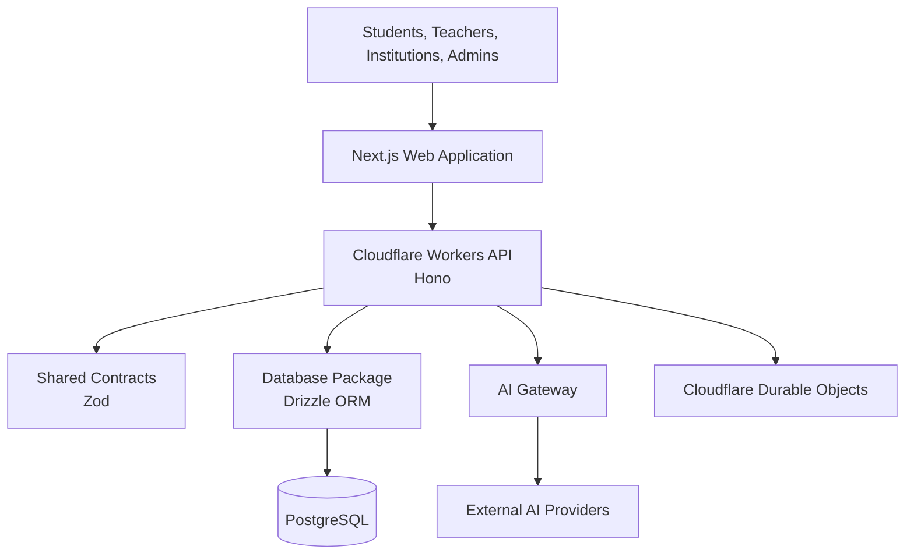

# Examinr — System Architecture

> Defines the technical architecture, application boundaries, infrastructure, and communication patterns that govern Examinr.

**Status:** Living specification  
**Architecture:** Modular monorepo  
**Runtime infrastructure:** Cloudflare  
**Primary application:** Next.js

---

## 1. Architecture Overview

Examinr is built as a modular monorepo containing independently organised applications and shared packages.

The architecture separates the user-facing application, backend services, database access, AI infrastructure, and shared contracts while keeping them within one repository.

The primary architectural goals are:

- Clear separation of responsibilities.
- Reusable functionality across applications.
- Strong type safety and validated contracts.
- Secure handling of student and institutional data.
- Scalable examination and learning workflows.
- Efficient AI request processing.
- Cost-conscious infrastructure.
- Maintainability without unnecessary architectural complexity.

The system should remain modular enough to evolve without requiring a complete rewrite when new features, user groups, or services are introduced.

## 2. Technology Stack

| Layer | Technology | Responsibility |
|---|---|---|
| Monorepo | pnpm | Workspace and dependency management |
| Build orchestration | Turborepo | Task orchestration and caching |
| Web application | Next.js | User-facing application |
| Language | TypeScript | Application and service development |
| API runtime | Cloudflare Workers | Backend request processing |
| API framework | Hono | HTTP routing and middleware |
| Real-time coordination | Cloudflare Durable Objects | Coordinated state and WebSocket sessions |
| Database | PostgreSQL | Persistent application data |
| ORM | Drizzle ORM | Database schema and queries |
| Validation | Zod | Runtime validation and shared schemas |
| AI infrastructure | Internal AI gateway | Provider integrations and model routing |
| Styling | Tailwind CSS | Interface styling |

Technology choices may evolve, but changes must be intentional and reflected in the relevant documentation.

## 3. Repository Architecture

The repository is divided into two primary areas: applications and shared packages.

```text
examinr/
├── apps/
│   ├── web/
│   └── api/
│
├── packages/
│   ├── ui/
│   ├── db/
│   ├── ai/
│   ├── contracts/
│   ├── eslint-config/
│   └── typescript-config/
│
├── docs/
│   ├── PRODUCT.md
│   ├── ARCHITECTURE.md
│   ├── DATABASE.md
│   ├── AI_SYSTEM.md
│   ├── DESIGN_SYSTEM.md
│   ├── ROADMAP.md
│   └── PROGRESS.md
│
├── AGENTS.md
├── CONTRIBUTING.md
├── package.json
├── pnpm-workspace.yaml
└── turbo.json
```

Existing Turborepo configuration packages should be reused and adapted rather than duplicated.

### 3.1 Applications

#### `apps/web`

The main Next.js application.

It contains the user-facing experiences for:

- Students.
- Teachers.
- Educational institutions.
- Platform administrators.

These experiences should initially live within one application, with clear route boundaries, layouts, and permission checks.

Separate applications should only be introduced when there is a concrete operational or architectural reason.

The web application is responsible for:

- Rendering user interfaces.
- Managing client-side interaction.
- Handling application navigation.
- Communicating with backend services.
- Managing appropriate client-side state.
- Presenting loading, error, and success states.

It must not become the authority for security-sensitive operations or access control.

#### `apps/api`

The backend API built with Hono and deployed on Cloudflare Workers.

It is responsible for:

- Authentication integration.
- Authorisation.
- Request validation.
- Application business operations.
- Database interactions through shared database infrastructure.
- AI gateway access.
- Examination workflows.
- Student and institutional operations.
- Background task coordination where appropriate.

The API is the trusted boundary between clients and protected application resources.

### 3.2 Shared Packages

#### `packages/ui`

Contains reusable interface components and shared UI foundations.

It should provide consistent components across the application without containing unnecessary application-specific business logic.

#### `packages/db`

Owns database-related functionality:

- Drizzle schema definitions.
- Database client configuration.
- Shared query utilities where appropriate.
- Database-related types.
- Migration support.

Applications should not independently redefine database schemas or establish unrelated database access patterns.

#### `packages/ai`

Contains Examinr's internal AI infrastructure.

Its responsibilities include:

- Provider adapters.
- Model configuration.
- Model routing.
- Request handling.
- Response normalisation.
- Usage tracking.
- Provider error handling.

Detailed behaviour belongs in `AI_SYSTEM.md`.

#### `packages/contracts`

Contains shared validation schemas and contracts used across applications and services.

It should help maintain consistency between client requests, API responses, and internal service boundaries.

Avoid duplicating schemas between the frontend and backend when a shared contract is appropriate.

#### Configuration packages

`packages/eslint-config` and `packages/typescript-config` contain shared development conventions.

They should provide consistent linting and TypeScript configuration throughout the monorepo.

---

## 4. Application Boundaries

Examinr has multiple user experiences, but they operate on shared platform infrastructure.

### Student experience

The student application handles:

- Academic profiles.
- Examination goals.
- Subjects and topics.
- Learning activities.
- Practice sessions.
- Examination attempts.
- AI tutoring.
- Performance analysis.
- Achievements.
- Account and subscription settings.

### Teacher experience

The teacher experience handles permitted educational and classroom workflows.

Its access must be restricted to the classes, students, and resources assigned to the teacher.

### Institution experience

The institution experience handles:

- Institution settings.
- Membership management.
- Classes and groups.
- Academic assignments.
- Assessments.
- Announcements.
- Institutional insights.

### Platform administration

The platform administration experience handles platform-wide operational responsibilities, including:

- User and institution administration.
- Platform configuration.
- AI provider credentials.
- Model configuration and routing.
- AI usage monitoring.
- Operational visibility.

Platform administration must have its own permission boundaries. Institution administrators must not automatically receive platform-wide administrative privileges.

### Shared infrastructure

All experiences use the same underlying platform capabilities where appropriate:

- Authentication.
- Database access.
- API services.
- AI infrastructure.
- Shared contracts.
- Notifications.
- Logging and monitoring.

The application must enforce tenant and role boundaries independently of which interface a user accesses.

---

## 5. High-Level System Design

The following illustrates the intended relationship between the major system components.



This is a logical architecture diagram. It does not imply that every request must pass through every component.

Services should only be involved when the requested operation requires them.

---

## 6. Communication Patterns

Different operations require different communication mechanisms.

Examinr should not use real-time infrastructure everywhere simply because it is available.

### 6.1 Standard HTTP

Use ordinary HTTP requests for operations that have a clear request-and-response lifecycle.

Examples:

- Fetching student profiles.
- Loading subjects.
- Retrieving examination history.
- Updating account settings.
- Submitting examination answers.
- Retrieving performance reports.
- Managing institution memberships.

### 6.2 HTTP Streaming and SSE

Use streaming responses where the client benefits from receiving incremental output.

Examples:

- Streaming AI tutor responses.
- Streaming long-form explanations.
- Progressively delivering generated learning content.

The API should preserve appropriate error handling, cancellation behaviour, and request limits.

### 6.3 WebSockets and Durable Objects

Use WebSockets when multiple participants or processes need coordinated, ongoing communication.

Cloudflare Durable Objects provide the coordination and state ownership needed for relevant real-time workflows.

Potential use cases include:

- Live multiplayer examination sessions.
- Synchronous classroom activities.
- Real-time participant presence.
- Coordinated session state.
- Live collaborative activities.

A Durable Object should own only the state and coordination responsibilities necessary for its workflow.

Persistent academic records should still be stored in PostgreSQL where appropriate.

### 6.4 Background Processing

Long-running or asynchronous operations should not unnecessarily block user-facing requests.

Potential use cases include:

- Bulk question processing.
- Large assessment generation.
- Scheduled notifications.
- Data aggregation.
- Institution-wide reporting.
- Deferred processing tasks.

Cloudflare Queues, Workflows, and scheduled Workers may be considered when a concrete requirement justifies them.

Do not introduce all of these services by default.

---

## 7. Authentication and Authorisation

Authentication establishes who a user is.

Authorisation determines what that user can access and perform.

These responsibilities must remain distinct.

### Authentication

The application should use a consistent authentication system across the different user experiences.

Authentication implementation must support:

- Account registration.
- Login and logout.
- Session management.
- Password management where applicable.
- Account recovery.
- Connected authentication methods where supported.

The specific authentication implementation and provider configuration must be documented before being treated as final architecture.

### Authorisation

Permissions must be enforced on the backend.

The system must account for:

- User identity.
- User role.
- Resource ownership.
- Institution membership.
- Assigned responsibilities.
- Resource-specific permissions.

A user must never gain access simply by modifying a client-side route, request parameter, or role value.

### Multi-tenant access

Institutional data must be isolated appropriately.

For example:

- A teacher should only access permitted institutional resources.
- A student should not access another student's private records.
- An institution administrator should not automatically access another institution.
- Platform administrators should use explicitly granted platform-level permissions.

Detailed roles, relationships, and database enforcement belong in `DATABASE.md`.

---

## 8. Database Connectivity

PostgreSQL is the persistent data store.

Drizzle ORM provides the schema and query layer through `packages/db`.

The backend should interact with the database through a shared database access layer rather than allowing unrelated applications to create independent database configurations.

### Connection strategy

The selected PostgreSQL connectivity solution must be compatible with the Cloudflare Workers runtime.

Cloudflare Hyperdrive is a potential connection-management layer for PostgreSQL workloads.

The final connection strategy must account for:

- Worker runtime compatibility.
- Connection pooling.
- Database provider support.
- Local development.
- Migration execution.
- Connection limits.
- Operational cost.

Do not assume that a conventional long-lived Node.js database connection can be used unchanged inside a Worker.

Database schema, entity relationships, migrations, and access patterns are defined in `DATABASE.md`.

---

## 9. AI Integration

AI functionality must be accessed through Examinr's internal AI gateway.

Applications should request capabilities rather than directly depending on individual model providers.

For example, an application feature should request an academic explanation or question-generation operation through the shared AI interface. The gateway determines the appropriate provider and model.

The gateway is responsible for:

- Provider selection.
- Model routing.
- Credential access.
- Request normalisation.
- Response handling.
- Usage tracking.
- Error handling.

The architecture must allow providers and models to change without requiring every application feature to be rewritten.

Detailed implementation belongs in `AI_SYSTEM.md`.

---

## 10. Security Architecture

Security must be applied across every system boundary.

### General requirements

- Enforce access control on the server.
- Validate untrusted input.
- Protect session credentials.
- Keep provider secrets server-side.
- Apply rate limits to sensitive operations.
- Prevent unauthorised resource access.
- Avoid logging sensitive student information.
- Protect institution-specific data.
- Use secure transport for external communication.

### Administrative operations

High-impact administrative operations require explicit authorisation.

Examples include:

- Changing AI provider credentials.
- Modifying model routing.
- Managing institution permissions.
- Changing account access.
- Accessing protected student records.

Important administrative changes should be auditable.

### Trust boundaries

The system should treat the following as untrusted:

- Browser requests.
- Client-side state.
- Uploaded files.
- External provider responses.
- AI-generated outputs.
- Third-party integrations.

Never use an AI-generated result as proof of authorisation or as a substitute for server-side validation.

---

## 11. Deployment and Environments

The system should support distinct environments for development, testing, and production.

### Development

Used for local development and integration testing.

Should support:

- Local web application.
- Local API development.
- Appropriate database connectivity.
- Test credentials and configuration.
- Safe test data.

### Production

Used for real students, teachers, and institutions.

Production must use:

- Production-specific credentials.
- Secure environment configuration.
- Appropriate database access.
- Production domain and routing.
- Monitoring and error reporting.
- Backup and recovery arrangements.

Never reuse production secrets in local development or commit environment-specific credentials.

### Deployment responsibilities

| Component | Deployment target |
|---|---|
| Web application | Next.js-compatible hosting |
| API | Cloudflare Workers |
| Durable Objects | Cloudflare |
| Database | Managed PostgreSQL |
| Shared packages | Consumed through the monorepo build |

The exact web hosting provider and PostgreSQL provider remain deployment decisions until explicitly finalised.

---

## 12. Scalability and Performance

Examinr should scale through sensible separation of responsibilities rather than premature distribution into numerous services.

### Application scalability

- Keep application logic modular.
- Avoid unnecessary synchronous dependencies.
- Use caching where it improves real workloads.
- Avoid repeated database queries.
- Paginate large collections.
- Use background processing for expensive operations.
- Keep API payloads appropriately sized.

### Examination scalability

Examination workflows require particular attention to reliability.

The system should account for:

- Multiple students starting assessments simultaneously.
- Timed sessions.
- Answer persistence.
- Submission reliability.
- Duplicate submissions.
- Network interruptions.
- Concurrent access.
- Result calculation consistency.

Critical examination submissions should be handled idempotently where appropriate.

A temporary network failure must not silently result in lost answers or inconsistent examination records.

### AI scalability

AI requests must account for:

- Provider quotas.
- Rate limits.
- Concurrent requests.
- Token usage.
- Request timeouts.
- Provider outages.
- Cost controls.

AI capacity should be managed independently of ordinary application API traffic.

---

## 13. Observability and Reliability

The platform should provide enough operational visibility to diagnose failures without exposing sensitive information.

Important areas include:

- API errors.
- Request latency.
- Database failures.
- Examination submission failures.
- AI provider errors.
- AI request usage.
- Background task failures.
- Real-time session failures.

Logs should use appropriate request or operation identifiers to connect related events.

Sensitive student content, passwords, session tokens, and provider credentials must not appear in logs.

The exact monitoring and error-reporting tools can be selected when deployment requirements are established.

---

## 14. Architectural Constraints

The following rules guide architectural decisions:

1. Keep the initial product in a modular monorepo.
2. Use the existing shared packages instead of duplicating functionality.
3. Keep backend security and authorisation authoritative.
4. Route AI functionality through the shared AI gateway.
5. Use PostgreSQL for persistent relational application data.
6. Use Durable Objects for coordination and real-time state only when necessary.
7. Use HTTP for ordinary request-response operations.
8. Use streaming for responses that benefit from incremental delivery.
9. Avoid unnecessary infrastructure and premature microservices.
10. Maintain compatibility with the Cloudflare Workers runtime.
11. Preserve clear boundaries between students, teachers, institutions, and platform administrators.
12. Keep implementation aligned with documented product requirements.

---

## 15. Open Architectural Decisions

These decisions require confirmation before their implementation is treated as final.

| Area | Current direction | Status |
|---|---|---|
| Monorepo | pnpm and Turborepo | Established |
| Web application | Next.js | Established |
| API runtime | Cloudflare Workers | Established |
| API framework | Hono | Established |
| Real-time coordination | Cloudflare Durable Objects | Established direction |
| Database | PostgreSQL | Established |
| ORM | Drizzle ORM | Established |
| Validation | Zod | Established |
| AI integration | Internal multi-provider gateway | Established |
| Authentication implementation | To be selected and specified | Open |
| PostgreSQL provider | Managed PostgreSQL | Open |
| PostgreSQL Worker connectivity | Hyperdrive or compatible alternative | Open |
| Web hosting provider | To be finalised | Open |
| Background processing services | Introduce when required | Open |
| Monitoring and error reporting | To be selected | Open |
| API versioning strategy | To be specified | Open |

Do not silently turn open decisions into permanent architectural commitments.

---

## 16. Relationship to Other Documentation

| Document | Responsibility |
|---|---|
| `PRODUCT.md` | Defines what Examinr should do |
| `DATABASE.md` | Defines how application data is structured and stored |
| `AI_SYSTEM.md` | Defines AI infrastructure and provider behaviour |
| `DESIGN_SYSTEM.md` | Defines interface design and implementation conventions |
| `ROADMAP.md` | Defines implementation priorities and milestones |
| `PROGRESS.md` | Records actual implementation status |

This document defines the system boundaries and technical direction. Detailed implementation decisions should live in their respective documents.

---

**End of System Architecture**